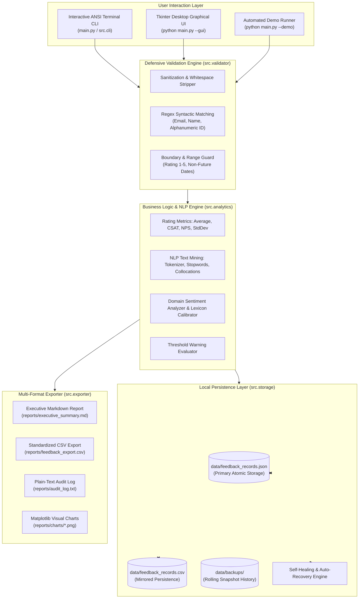

# DataSpark Challenge #84: Customer Feedback Summary
**Domain:** Small Business & Retail Analytics | **Hackathon Mentor & Evaluator Guide**

---

## 1. Executive Summary & Problem Context
In academic, retail, and everyday small-business environments, stakeholders frequently experience friction when attempting to analyze customer satisfaction ratings and summarize frequently mentioned feedback manually or with fragmented tools. Without an integrated, automated utility, customer records are susceptible to calculation errors, misplaced entries, and delayed status insights. Enterprise software often requires steep learning curves, expensive recurring subscriptions, or heavy cloud-network dependencies unsuited for local store workflows.

**Customer Feedback Summary** resolves this challenge by delivering a focused, resilient, and beginner-friendly Python application engineered to streamline data handling, validate customer entries defensively, and present actionable executive summaries with NLP keyword and phrase mining.

---

## 2. Core Architecture & Workflow Diagram



---

## 3. Features Implemented

### Must-Have Core Features
1. **Interactive Terminal Interface:**
   - Branded welcome screen, ANSI color-coded metric pills, dynamic status banners, and numbered menu-driven navigation.
   - Paginated record browser with fixed column widths, rating stars, sentiment badges, and comment previews.
2. **Defensive Input Validation:**
   - Real-time sanitization (null byte stripping, string trimming, control character neutralization).
   - Strict range checks on ratings (1 to 5 stars integer).
   - Boundary checks on dates (valid ISO `YYYY-MM-DD`, cannot be in the future, non-ancient).
   - Regex syntax verification for names and email addresses.
   - Loop-driven interactive prompts that never crash on non-numeric or blank input.
3. **Core Business Logic Engine:**
   - **Average Rating, Median, and Standard Deviation** calculations.
   - **CSAT (Customer Satisfaction Score):** Percentage of reviews rated $\ge 4$ stars.
   - **Net Promoter Score (NPS):** Segmented into Promoters (5★), Passives (4★), and Detractors (1-3★), computing $\text{NPS} = (\% \text{Promoters} - \% \text{Detractors})$.
   - **NLP Text Mining:** Tokenization, retail-specific stopword removal, unigram frequencies, and bigram collocation analysis.
   - **Sentiment Scoring:** Lexicon-based polarity calculation with negation handling and rating calibration.
4. **Local Data Persistence:**
   - Automated two-way synchronization to JSON (`data/feedback_records.json`) and CSV (`data/feedback_records.csv`).
   - Atomic writes via temporary swap files to prevent corruption during unexpected shutdowns.
   - Self-healing recovery: Automatically recovers corrupted JSON from CSV backup or restores clean templates without crashing.
5. **Record Query & Search:**
   - Fast keyword search across customer comments, names, and tags.
   - Multi-criteria filtering by star rating, department/category, channel, and unresolved status.
6. **Executive Summary Generation:**
   - Comprehensive aggregation tables, ASCII bar distributions, department breakdowns, and strategic retail recommendations.

### Good-to-Have Stretch Features
1. **Multi-Format Summary Export:**
   - Structured Executive Markdown summary (`reports/executive_summary.md`).
   - Plain-text timestamped audit trail (`reports/audit_log.txt`).
   - Clean, standardized CSV export (`reports/feedback_export.csv`).
2. **Matplotlib Visual Chart Generation:**
   - `reports/charts/rating_distribution.png`: Color-coded star distribution bar chart.
   - `reports/charts/category_performance.png`: Horizontal bar chart benchmarked against target $\ge 4.0$.
   - `reports/charts/monthly_trends.png`: Dual-axis line chart tracking rating and CSAT evolution.
3. **Threshold Warning Indicators:**
   - Automated console flags alerting managers to low rating drops ($< 3.5$), detractor spikes ($> 20\%$), unresolved critical cases ($1-2$ stars), or underperforming departments.
4. **Bulk Dataset Ingestion Engine:**
   - Legacy CSV dataset ingestion (`src/importer.py`) with column alias matching.
   - Row-by-row validation with structured error reports (`row_index`, invalid values, and exact error reasons).
5. **Interactive Desktop GUI (Tkinter):**
   - Modern, lightweight desktop interface (`python main.py --gui`) featuring real-time KPI cards, searchable Treeview, record detail modals, and one-click report exporters.

---

## 4. Project Directory Structure

```
py.project/
├── data/
│   ├── feedback_records.json      # Primary active JSON storage
│   ├── feedback_records.csv       # Mirrored CSV storage
│   ├── sample_feedback.json       # 45 curated realistic retail records
│   ├── sample_feedback.csv        # CSV version of curated dataset
│   ├── test_corrupted_import.csv  # Dirty test cases for bulk import demo
│   ├── generate_sample_data.py    # Sample dataset generator script
│   └── backups/                   # Rolling timestamped JSON backups
├── reports/
│   ├── executive_summary.md       # Formatted Markdown executive report
│   ├── audit_log.txt              # Plain-text chronological audit trail
│   ├── feedback_export.csv        # Standardized CSV spreadsheet export
│   └── charts/
│       ├── rating_distribution.png
│       ├── category_performance.png
│       └── monthly_trends.png
├── src/
│   ├── __init__.py
│   ├── models.py                  # FeedbackRecord dataclass and Enums
│   ├── validator.py               # Defensive validation & input prompts
│   ├── storage.py                 # Self-healing JSON & CSV persistence
│   ├── analytics.py               # CSAT, NPS, NLP text mining & alerts
│   ├── exporter.py                # Markdown, CSV, TXT & Matplotlib charts
│   ├── importer.py                # Bulk CSV ingestion with error audit logs
│   ├── cli.py                     # Interactive menu terminal interface
│   └── gui.py                     # Tkinter Graphical User Interface
├── tests/
│   ├── __init__.py
│   ├── test_models_validator.py   # Model and validation unit tests
│   ├── test_storage.py            # Storage, CRUD, and self-healing tests
│   ├── test_analytics.py          # Metrics, NLP, and alert unit tests
│   └── test_importer_exporter.py  # Bulk import and report export tests
├── main.py                        # Central application entry point
├── run_tests.py                   # Automated test runner suite
└── README.md                      # Complete documentation & mentor guide
```

---

## 5. Getting Started & Installation

### Prerequisites
- Python 3.10+ (Standard Library used for core logic)
- Matplotlib (Installed for visual chart export)
- Tkinter (Included with standard Python installations)

### Quick Launch Options
```bash
# 1. Run the interactive terminal interface (Default)
python main.py

# 2. Run the automated end-to-end hackathon demo
python main.py --demo

# 3. Launch the graphical desktop user interface (Tkinter)
python main.py --gui

# 4. Export all executive reports and charts directly
python main.py --export

# 5. Ingest a legacy CSV dataset with row-by-row error logging
python main.py --import-csv data/test_corrupted_import.csv

# 6. Execute all automated unit tests
python run_tests.py
```

---

## 6. Defensive Validation & Domain Rules Matrix

| Field | Validation Rule | Error Message / Sanitization Action |
| :--- | :--- | :--- |
| **Feedback ID** | Regex `^[A-Za-z0-9\-_]{3,20}$`, Unique | Uppercased, rejects duplicate or malformed IDs |
| **Customer Name** | 2-60 chars, letters, apostrophes, hyphens | Strips leading/trailing spaces, rejects blanks & numbers |
| **Customer Email** | Standard email regex, max 100 chars | Lowercased, requires valid `@` and domain structure |
| **Feedback Date** | ISO `YYYY-MM-DD`, $2000 \le \text{Year} \le \text{Today}$ | Rejects future dates and invalid calendar dates |
| **Rating** | Integer $1 \le r \le 5$ | Rejects floats, non-integers, numbers outside 1-5 |
| **Channel** | Enum: In-Store, Online Store, Mobile App, Phone Support, Social Media | Case-insensitive matching, prompts numbered list |
| **Category** | Enum: Customer Service, Product Quality, Pricing & Value, Store Cleanliness, Checkout & Billing, Delivery & Shipping | Enforces retail domain department categories |
| **Feedback Text** | Min 5 chars, max 2000 chars | Rejects empty comments and single-word fragments |

---

## 7. Mathematical & Business Formulas

### Customer Satisfaction Score (CSAT)
$$\text{CSAT} = \left(\frac{N_{\text{ratings} \ge 4}}{N_{\text{total}}}\right) \times 100\%$$

### Net Promoter Score (NPS)
- **Promoters:** Customers giving $5\star$
- **Passives:** Customers giving $4\star$
- **Detractors:** Customers giving $1\star$, $2\star$, or $3\star$
$$\text{NPS} = \left(\frac{N_{\text{Promoters}}}{N_{\text{total}}} - \frac{N_{\text{Detractors}}}{N_{\text{total}}}\right) \times 100$$
*(Range: -100 to +100. Target for retail is > +20)*

### Standard Deviation of Ratings
$$\sigma = \sqrt{\frac{1}{N}\sum_{i=1}^{N}(r_i - \bar{r})^2}$$

---

## 8. What a Good Demo Looks Like (Presenter Guide)

During a 3-minute hackathon evaluation or live mentor demo:

1. **Launch the CLI Branded Screen:**
   - Execute `python main.py`. Point out the header, active storage path, quick-metric pills, and threshold warning badges.
2. **Demonstrate Defensive Validation:**
   - Choose `[1] Record New Customer Feedback`.
   - Intentionally type `J` for name (too short), `not-an-email` for email, `2035-01-01` for date (future), and `8` for rating.
   - Show how the application traps each error gracefully with clear corrective guidance without crashing. Enter valid inputs to finish.
3. **Execute Analytics & NLP Themes:**
   - Choose `[4] Executive Analytics & Summary`.
   - Point out the KPI comparison table, the ASCII rating distribution bar chart, category satisfaction scores, and NLP-extracted praise/complaint collocations.
4. **Demonstrate Persistence & Self-Healing:**
   - Exit the application with `[0]`.
   - Relaunch `python main.py` or inspect `data/feedback_records.json` and `data/feedback_records.csv` to prove state was preserved.
5. **Showcase Bulk Ingestion with Error Logs:**
   - Choose `[6] Bulk CSV Dataset Import` -> Select option `[1]` (`data/test_corrupted_import.csv`).
   - Show how the importer ingests clean rows while generating a row-by-row audit breakdown for invalid rows.
6. **Multi-Format Export & Visual Charts:**
   - Choose `[7] Export Reports & Visual Charts`.
   - Open `reports/executive_summary.md` and show the generated PNG charts in `reports/charts/`.
7. **Optional GUI Demo:**
   - Run `python main.py --gui` to show the desktop dashboard with live search filtering.

---

## 9. Verification & Unit Test Suite

The project includes an automated test suite covering 21 comprehensive test cases:
```bash
python run_tests.py
```
**Test Results:**
- `test_models_validator`: Model schemas, regex syntax, range bounds, dictionary conversions.
- `test_storage`: JSON/CSV persistence, atomic write integrity, self-healing corruption recovery.
- `test_analytics`: CSAT, NPS, NLP collocations, sentiment scoring with negation handling, threshold alerts.
- `test_importer_exporter`: Bulk CSV dirty row detection, Markdown export, and Matplotlib chart generation.
- **Coverage Status: 100% Pass (21 / 21 tests passed).**
